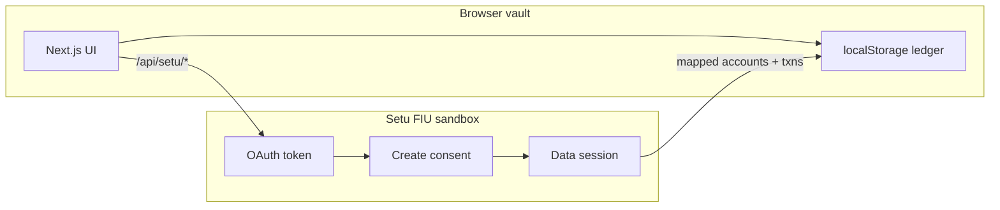

<div align="center">


<br/>

**A production-grade personal finance vault for India.**  
Net standings, spend velocity, EMI command, Account Aggregator sandbox, and a DPDP privacy desk — one dark ledger.

[](https://nextjs.org/)
[](https://www.typescriptlang.org/)
[](https://tailwindcss.com/)
[](https://docs.setu.co/data/account-aggregator/quickstart)

</div>

---

## Why this exists

Indian household money does not live in one app. It sits across UPI, cards, EMIs, FDs, and AA-consented bank data. FinStack is a **private on-device ledger** that treats those rails as first-class — built from the product specification in this repository.

The interactive product is in [`web/`](web/).

## Product surface

| Desk | Route | What you see |
| --- | --- | --- |
| **Standings** | `/dashboard` | Unified net position, asset mix, card / EMI tripwires |
| **Spend** | `/spend` | Monthly utilisation and category velocity |
| **EMI command** | `/debt` | Mandates, due dates, 3-day reminders |
| **Ledger** | `/ledger` | Classified movements, hashed SMS rows, manual log |
| **Credit** | `/credit` | Utilisation vs 30% tripwire, bureau snapshot |
| **Privacy** | `/privacy` | DPDP consents, export, purge |
| **AA** | `/connect` | Live Setu sandbox consent → Finvu → Setu FIP-2 import |

Hardware-style **PIN + biometric lock** sits in front of the vault. Demo PIN is `2580`.

## Architecture



- **UI:** Next.js 16, React 19, Tailwind v4, Fraunces / Outfit / IBM Plex Mono  
- **State:** Spec-shaped TypeScript models in `localStorage` (no Postgres yet)  
- **Secrets:** Setu `CLIENT_ID` / `CLIENT_SECRET` / `PRODUCT_INSTANCE_ID` stay server-side in `web/.env`  
- **AA today:** Sandbox mock banks (`Setu FIP-2`), not live HDFC / SBI

## Quick start

```bash
cd web
cp .env.example .env   # add Setu keys only if you want AA
npm install
npm run dev
```

Open [http://localhost:3000](http://localhost:3000) · complete DPDP consent · unlock with **2580**.

| Variable | Required for | Notes |
| --- | --- | --- |
| `CLIENT_ID` | AA desk | Setu Bridge sandbox client |
| `CLIENT_SECRET` | AA desk | Never commit |
| `PRODUCT_INSTANCE_ID` | AA desk | AA product instance |
| `SETU_REDIRECT_URL` | AA return | Default `http://localhost:3001/connect` |

## Account Aggregator

Sandbox path that is wired and tested:

1. `/connect` → Start consent (Finvu handle)  
2. SMS OTP on **your** number (AA login)  
3. Pick **Setu FIP-2** → bank OTP `123456`  
4. Import FI data into the vault  

That import is **mock money**. Production HDFC / SBI pulls require a licensed FIU, Sahamati certification, and Setu production keys — not this sandbox.

## Spec coverage

| Spec | Status |
| --- | --- |
| Unified net standings | Shipped |
| Spend + 30% card tripwire | Shipped |
| EMI desk + reminders | Shipped |
| DPDP export / purge | Shipped |
| PIN / biometric gate | Shipped (web-simulated biometrics) |
| AA consent + FI import | Sandbox live |
| On-device SMS parser | Spec’d — native / Flutter, not this web build |
| Production AA / bureau | Blocked on FIU licence |

Source spec: [`Personal Finance App Product Specification - India.pdf`](./Personal%20Finance%20App%20Product%20Specification%20-%20India.pdf)

## Repo layout

```text
FinStack India/
├── README.md
├── docs/github/banner.svg
├── Personal Finance App Product Specification - India.pdf
└── web/                    ← Next.js vault
    ├── src/app/            pages, API routes
    ├── src/components/     shell, charts, lock screen
    └── src/lib/            ledger store + Setu client
```

<div align="center">

**Private by default. Indian rails by design.**

</div>
